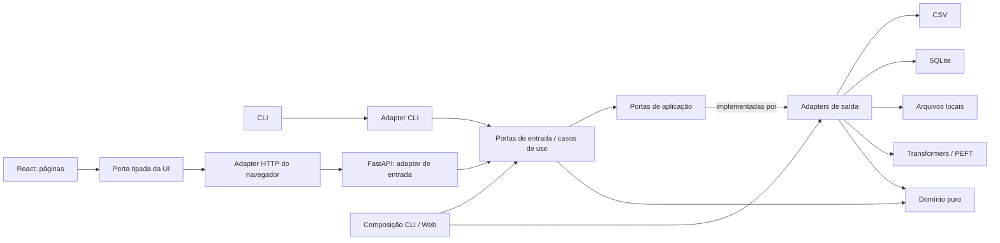

# FinLabel — Clean Architecture e arquitetura hexagonal

**Estado:** proposta para aprovação
**Base:** `codex/finlabel-autonomous-mvp` (`2b11cca`)
**Escopo escolhido:** reorganização completa em uma campanha coordenada, mantendo o comportamento e os contratos existentes.

## Intenção

Reorganizar todo o código do FinLabel para que regras de negócio e casos de uso não dependam de FastAPI, argparse, caminhos locais, CSV/SQLite, Transformers, PEFT ou detalhes de serialização. Isso deve tornar os fluxos verificáveis por interfaces pequenas, concentrar integrações nos adapters e permitir substituir uma origem ou backend sem alterar regras de domínio.

A implementação cobre o pacote Python e a fronteira do React. Páginas React dependem de uma porta de aplicação do cliente; o adapter HTTP local implementa essa porta e testes usam um adapter em memória. Regras financeiras e decisões de treinamento permanecem em um único domínio no Python, sem duplicação no navegador.

## Objetivos

- Definir e aplicar a regra de dependência entre domínio, aplicação, portas, adapters e composição.
- Mover os módulos existentes para uma organização explícita sem mudar resultados ou políticas.
- Injetar dependências de dados, inferência/treino, persistência e registro nos casos de uso.
- Preservar CLI, rotas HTTP, configuração de projeto, formatos dos artefatos locais e imports públicos atuais por fachadas de compatibilidade.
- Separar apresentação React do transporte HTTP por uma interface substituível e manter os mesmos payloads e estados de tela.
- Verificar as regras arquiteturais automaticamente e manter a suíte existente passando.

## Fora do escopo

- Alterar rótulos, gates, políticas, fórmulas analíticas, segurança, privacidade ou decisões autônomas.
- Criar funcionalidades, conectores, formatos persistidos ou dependências de runtime novas.
- Converter a aplicação em microserviços ou mudar seu modo local de execução.
- Remover as fachadas antigas nesta campanha. Uma remoção posterior exige versão e política de depreciação próprias.

## Abordagens

1. **Reorganização completa de uma vez — escolhida pelo usuário.** Criar a estrutura-alvo e mover todo o código em uma campanha integrada. Preservar caminhos usados externamente por módulos de fachada. Vantagem: dependências finais coerentes desde a conclusão; custo: diff abrangente e risco de import quebrado durante a migração.
2. **Migração incremental com a estrutura antiga como arquitetura permanente.** Adicionar portas e casos de uso sem mover os módulos. Reduz o diff inicial, mas deixa duas organizações concorrentes e não entrega a reorganização solicitada.
3. **Documentar apenas as camadas.** Menor custo, sem impacto no código, mas não altera dependências atuais.

## Regras arquiteturais

- **Domínio:** tipos, invariantes, validação e cálculo puros. Não importa aplicação, adapters, frameworks, filesystem, bases, modelos ou rede.
- **Aplicação:** portas de entrada/casos de uso e portas de saída. Casos de uso orquestram domínio e portas; recebem dependências por composição/injeção e não constroem adapters concretos nem acessam I/O diretamente.
- **Portas:** interfaces pequenas requeridas pelos casos de uso, agrupadas por capacidade. Tipos de domínio atravessam essas interfaces; não expor detalhes de FastAPI ou Transformers.
- **Adapters de saída:** implementam portas para CSV, SQLite, workspace local, artefatos, registry, Transformers e PEFT.
- **Adapters de entrada:** CLI e FastAPI convertem argumentos/requests em chamadas das portas de entrada da aplicação e convertem resultados/erros para seus protocolos.
- **Composição:** entrypoints montam adapters e casos de uso. É a única camada que conhece simultaneamente as implementações concretas e os casos de uso.
- **React:** apresentação e cliente HTTP seguem a mesma regra: páginas dependem de uma porta tipada da aplicação web; adapter HTTP converte chamadas em requests locais e DTOs wire em dados da apresentação; adapter em memória serve aos testes. Não há cópia do domínio financeiro, de rotulagem, avaliação ou promoção no navegador.
- Dependências sempre apontam para dentro: adapters e composição podem depender das portas e aplicação; domínio não aponta para camadas externas.
- Cada seam deve corresponder a uma variação real: CSV e SQLite para leitura; implementações reais e em memória/fakes para testes; backends locais e substitutos controlados para inferência/treino.

## Organização alvo

```text
src/finlabel/
  domain/                 # modelos e regras puras por capacidade
    analysis/
    labeling/
    training/
    monitoring/
    projects/
  application/
    ports/                # protocolos consumidos pelos casos de uso
    use_cases/            # análise, monitoramento, labeling e ciclo de treino
  adapters/
    inbound/
      cli/
      http/               # FastAPI, rotas, schemas e entrega do painel local
    outbound/
      sources/            # CSV e SQLite somente leitura
      models/             # Transformers
      training/           # PEFT/TRL
      persistence/        # configuração, runs, artefatos e registry locais
  bootstrap/              # composição dos entrypoints
  cli.py                  # fachada pública finlabel.cli:main
  project.py              # fachada pública para configuração legada
  ...                     # outras fachadas públicas existentes
frontend/src/
  application/ports/      # contrato tipado usado pela apresentação
  adapters/http/          # adapter HTTP e mapeamento de DTOs
  adapters/in-memory/     # fake substituível em testes
  presentation/           # páginas e componentes React
  bootstrap/              # composição do cliente e providers
```

Os diretórios internos serão agrupados por capacidade dentro de cada camada quando isso reduzir acoplamento. O plano de implementação vai mapear cada arquivo atual para um destino; esta especificação fixa a direção, não força um arquivo por classe nem uma porta genérica para todo o filesystem.



## Compatibilidade e migração

- `finlabel` continua instalável com os mesmos extras opcionais e `finlabel = finlabel.cli:main` permanece o entrypoint do console.
- `finlabel.cli:main`, `finlabel.web.app:create_app`, os exports atuais de `finlabel`, `finlabel.analysis`, `finlabel.labeling` e os imports públicos documentados continuam disponíveis por fachadas finas.
- Rotas, métodos, payloads, códigos de erro observáveis pelo cliente e estados de tela permanecem iguais; o novo cliente HTTP converte os mesmos DTOs wire para a apresentação.
- Paths de configuração, `project.json`, JSON/JSONL de resultados, IDs/hashes, rotas e payloads HTTP permanecem compatíveis byte a byte onde o contrato atual assim exige.
- Os callers internos serão migrados para caminhos canônicos novos. Somente chamadas legadas e os testes de compatibilidade importarão as fachadas.
- A campanha fará a reorganização em uma branch de integração isolada; `main` não será alterada. Commits e branches de revisão separarão fundação/contratos, domínio e casos de uso, adapters/composição e validação final.

## Verificação e critérios de aceite

- Um teste de arquitetura baseado em AST impõe as regras de importação em cada camada e bloqueia dependência de domínio/aplicação em FastAPI, CLI, I/O, Transformers ou módulos de adapters.
- Os fluxos de análise, monitoramento, labeling autônomo, trusted training, avaliação, promoção/rollback e persistência passam por portas injetadas; fakes em memória comprovam execução sem adapters reais.
- Páginas React testadas contra adapter em memória não chamam `fetch` diretamente; o adapter HTTP preserva métodos, URLs, CSRF, idempotência e schemas existentes.
- Testes de compatibilidade provam os imports antigos, CLI, rotas/payloads, arquivos persistidos e carregamento lazy de extras opcionais.
- A suíte Python completa, testes React, build, lint, `compileall` e `git diff --check` passam.
- QA de navegador confirma que as rotas e o painel permanecem funcionais depois da composição FastAPI.
- Nenhum fluxo acessa fonte CSV/SQLite em escrita; nenhum dado bruto deixa os limites locais estabelecidos.

## Decisões do implementador

- Escolher nomes e assinaturas específicos das portas a partir dos dois ou mais adapters de cada seam real; manter a menor interface útil.
- Escolher o destino de módulos com responsabilidades mistas após separar domínio puro de efeitos locais.
- Usar fachadas sem lógica como mecanismo temporário de compatibilidade, sem permitir que módulos novos dependam delas.
- Adotar testes AST com biblioteca padrão, evitando dependência de runtime ou ferramenta adicional.
