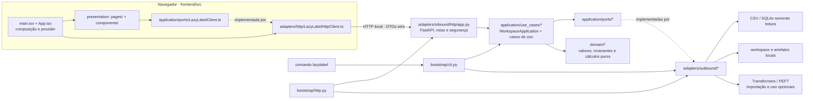

# LazyLabel: Clean Architecture e arquitetura hexagonal

Este documento descreve a arquitetura implementada no LazyLabel. Os caminhos abaixo são relativos à raiz do repositório. As regras de dependência executáveis estão em `tests/architecture/test_layer_dependencies.py`.

## Fluxo e dependências

As dependências do Python apontam para dentro: domínio → nada externo ao domínio; aplicação → domínio e portas; adapters → aplicação/domínio; bootstrap → todas as camadas para conectá-las. Os casos de uso recebem suas dependências e não criam adapters concretos nem executam I/O diretamente. A origem CSV/SQLite é acessada por adapters de leitura.



No diagrama, `lazylabel.bootstrap.cli:run` é o entrypoint do comando `lazylabel` e delega ao adapter CLI. `lazylabel.bootstrap.http:create_app` compõe o adapter HTTP. Na interface, `frontend/src/main.tsx` cria o `LazyLabelHttpClient`, e `frontend/src/App.tsx` fornece o cliente tipado às páginas. Apenas `frontend/src/adapters/http/LazyLabelHttpClient.ts` faz requests de rede; `LazyLabelMemoryClient.ts` implementa a mesma porta para testes.

## Camadas Python

| Camada | Caminhos canônicos | Responsabilidade |
| --- | --- | --- |
| Domínio | `src/lazylabel/domain/{analysis,labeling,monitoring,projects,training}/` | Valores, validações, regras e cálculos independentes de frameworks, I/O, rede e adapters. |
| Aplicação | `src/lazylabel/application/use_cases/` | Orquestração de workspace, projetos, monitoramento, análise, rotulagem e ciclo de treino, via portas injetadas. |
| Portas de saída | `src/lazylabel/application/ports/` | Protocolos requeridos pela aplicação para fontes, workspace/persistência, modelos, análise, rotulagem e treinamento. |
| Adapters de entrada | `src/lazylabel/adapters/inbound/{cli,http}/` | Tradução dos argumentos CLI e requests HTTP para chamadas da aplicação; a camada HTTP contém rotas, schemas, segurança local e entrega do painel. |
| Adapters de saída | `src/lazylabel/adapters/outbound/{sources,persistence,models,training}/` | Leitura CSV/SQLite; arquivos e registros locais; integração opcional de modelos e treino. |
| Composição | `src/lazylabel/bootstrap/` | `application.py` monta workspace e serviços; `cli.py` e `http.py` conectam os entrypoints aos adapters concretos. |

`WorkspaceApplication` em `application/use_cases/workspace.py` expõe operações compartilhadas pelos entrypoints e delega cálculos/orquestrações menores aos casos de uso. Os tipos e decisões não devem ser copiados para as rotas ou para o React. Erros de negócio são definidos na aplicação/domínio e traduzidos pelo adapter de entrada para a resposta CLI ou HTTP compatível.

### Portas e adapters atuais

- `application/ports/sources.py` define leitura e perfil da fonte; `adapters/outbound/sources/csv_source.py` e `sqlite_source.py` a implementam sem escrita na origem.
- `application/ports/projects.py` e `workspace.py` definem lookup e operações locais do workspace; `adapters/outbound/persistence/workspace.py` e os stores em `persistence/` implementam configuração, consultas e artefatos.
- `application/ports/analysis.py` e `labeling.py` isolam planejador/preditor e persistência de resultados. Implementações locais de modelo ficam em `adapters/outbound/models/`.
- `application/ports/training.py` descreve dados confiáveis, treino, avaliação, registry e ciclo; `adapters/outbound/training/` executa os efeitos. O domínio em `domain/training/` decide validações, métricas, gates e razões de promoção/rejeição.
- Em `frontend/src/application/ports/LazyLabelClient.ts`, a interface do navegador descreve as operações consumidas pelas páginas. `frontend/src/adapters/http/LazyLabelHttpClient.ts` mapeia o contrato HTTP; `frontend/src/adapters/in-memory/LazyLabelMemoryClient.ts` oferece resultados determinísticos em testes.

## Composição e extensões

### Adicionar uma fonte de dados

1. Defina a capacidade de leitura necessária em `src/lazylabel/application/ports/sources.py`; mantenha a interface limitada ao que os casos de uso consomem.
2. Implemente o conector em `src/lazylabel/adapters/outbound/sources/`, respeitando o contrato de somente leitura e convertendo falhas do driver em erros tipados da fonte.
3. Registre a seleção do conector na composição em `src/lazylabel/bootstrap/application.py`. Não faça essa seleção dentro de casos de uso ou do domínio.
4. Adicione testes de contrato com dados temporários, incluindo evidência de que arquivos/bancos da origem não mudam, e atualize testes de arquitetura apenas se a direção permitida entre camadas realmente mudar.

Hoje o bootstrap seleciona CSV e SQLite a partir de `SourceSpec.kind`. Adicionar um conector não altera o formato HTTP nem deve exigir regras financeiras duplicadas.

### Adicionar um backend de modelo ou treino

1. Reuse a porta apropriada em `application/ports/analysis.py`, `labeling.py` ou `training.py`. Se faltar capacidade, altere primeiro a interface de aplicação e seus fakes/contratos.
2. Implemente a integração em `adapters/outbound/models/` ou `adapters/outbound/training/`; mantenha imports de Transformers/PEFT/TRL lazy para que importar o pacote e a CLI não exija os extras.
3. Selecione o backend em `bootstrap/application.py` e injete-o na aplicação. Não importe a implementação concreta a partir de domínio, caso de uso, rota ou página React.
4. Valide respostas, falhas e artefatos sem permitir promoção quando evidência ou política estiver ausente/inválida. A política de confiança, avaliação congelada, promoção e rollback continua no domínio/aplicação.

### Alterar o cliente web

As páginas e componentes em `frontend/src/pages/` e `frontend/src/components/` consomem `LazyLabelClient` pelo provider. Uma nova operação começa na porta tipada, recebe implementação no adapter HTTP e no adapter em memória, e só então é usada pela apresentação. O backend Python permanece a fonte única para regras de negócio.

## Caminhos de import

Importe sempre pelo caminho canônico (`lazylabel.domain`, `lazylabel.application`, `lazylabel.adapters` ou `lazylabel.bootstrap`). As antigas fachadas de compatibilidade foram removidas em 09/11/2026; a tabela de correspondência está em `clean-hexagonal-module-map.md`. `tests/architecture/test_layer_dependencies.py` bloqueia módulos fora dessas camadas.

## Verificações reproduzíveis

Todos os comandos rodam a partir de `codigo/lazylabel/`. É necessário Python >=3.10 (conforme `pyproject.toml`). Os extras `models` e `train` (torch, transformers) não são necessários para rodar os testes.

Configuração do ambiente (Python e frontend):

```bash
python -m venv .venv
.venv/bin/python -m pip install -e '.[web,test]' pytest
npm --prefix frontend ci
```

Verificações:

```bash
.venv/bin/python -m pytest -q
npm --prefix frontend test -- --run
npm --prefix frontend run build
npm --prefix frontend run lint
.venv/bin/python -m compileall -q src tests
git diff --check
```

Os testes de dependência também podem ser executados isoladamente: `.venv/bin/python -m pytest tests/architecture -q`. O build produz os assets React locais usados pelo FastAPI; o servidor deve ficar ligado somente ao loopback.
