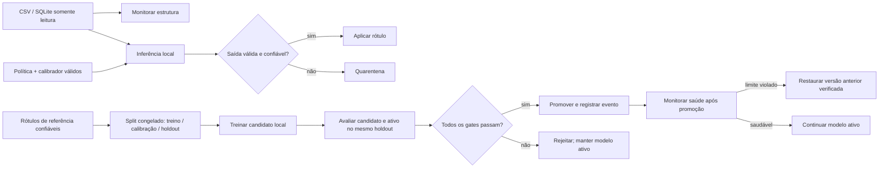

# Verified local training cycle

The `lazylabel run` command uses the configured task policy to label the current read-only source, then runs one local training cycle. Labels that do not pass policy, rule, freshness, and calibration checks are quarantined. Trusted labels are a separate configured source and are the only target values used for the train/calibration/holdout partitions. The cycle:

1. Loads the one explicitly registered trusted-label source for the task. A changed source snapshot requires the existing explicit supervision refresh action.
2. Reuses or creates the immutable train, calibration, and holdout partitions under .lazylabel/trusted-datasets/<task>/<snapshot-sha256>/.
3. Requires .lazylabel/training-gate.json, the task labeling policy, and .lazylabel/models/promotion-policies/<task>.json. Training uses only the train partition.
4. Fits separate candidate and incumbent calibrators on the same frozen calibration partition.
5. Runs candidate and incumbent Transformers/PEFT inference on the same frozen holdout with label_json_mean_log_likelihood_v2.
6. Applies every configured task policy gate. A failure leaves .lazylabel/models/active-models.json unchanged. Missing or invalid prerequisites record a blocked cycle.

Before the first promotion, the incumbent is the task's exact base model and revision. Later evaluations use the active adapter as incumbent. A promotion compares both models on identical frozen calibration and holdout rows.

An unchanged trusted snapshot, task specification, labeling policy, training gate, promotion policy, and active incumbent are processed once. A change to any of these identities creates a new cycle. A blocked cycle may be retried after its prerequisite is corrected. Existing partitions are rebuilt from the freshly loaded registered source and compared byte-for-byte with both the manifest and train/calibration/holdout files; an edited artifact is rejected.

## Task-specific gates

Create .lazylabel/models/promotion-policies/<task>.json with exactly these fields:

    {
      "task_id": "risk",
      "version": "risk-policy-2026-01",
      "required_metrics": {"macro_f1": 0.8},
      "minimum_coverage": 0.95,
      "allowed_per_label_regression": {"low": 0.02, "medium": 0.02, "high": 0.01},
      "max_calibration_error": 0.08,
      "rollback_monitor_limits": {"accuracy": 0.75},
      "min_holdout_count": 30
    }

The values above illustrate the schema only. Choose metric names and thresholds for the task's evaluation protocol and evidence; LazyLabel does not supply universal thresholds. Supported evaluator metrics are accuracy, macro_f1, brier_score, calibration_error, and coverage. Per-label regression gates compare F1 for every named task label. A metric omitted from required_metrics is not given an implicit minimum.

The existing training gate remains explicit and local. It must include the approved model_id, license, hardware, data_policy, evaluation_protocol, and authorized: true. The cycle uses the task's exact base model ID and revision; mismatches fail closed. Candidate and evaluation evidence record the gate path and digest. Every promotion entry point reloads and hashes that file at the promotion decision while holding the registry lock; a missing or changed gate rejects the candidate and leaves the active pointer unchanged. The lock serializes registry promotion decisions, but external filesystem edits are not transactionally coordinated and could race within the small interval between gate validation and the decision.

## Calibration reference and artifact location

The task labeling policy's calibration_ref is a stable policy slot such as risk-confidence-v1. It does not identify a particular model or file. For each exact model, evaluation writes an immutable artifact to:

.lazylabel/models/calibrators/<task>/<policy-id>/<model-digest>.json

The artifact binds that slot to the exact task specification, full labeling-policy digest, model reference, ordered labels, score method, and calibration partition/manifest/data hashes. Candidate and incumbent artifacts use different model digests and never overwrite each other. Active inference loads the artifact recorded with the promoted adapter and verifies the model reference and full policy digest before applying labels. A missing, malformed, or mismatched calibrator leaves predictions quarantined or blocks the run.

The calibration slot is a namespace from the task policy. It is not expected to equal a model-specific calibration digest. A distinct immutable artifact is stored for each exact model identity under that slot.

## Evaluation evidence and local data

Evaluation JSON is stored at .lazylabel/models/evaluations/<evaluation-id>.json. Alongside content hashes and aggregate metrics, it contains privacy-minimized row evidence needed to independently recompute holdout coverage, confusion counts, per-label scores, accuracy, Brier score, and calibration error: opaque record references, input digests, trusted targets, predicted labels or abstentions, raw label scores, calibrated confidence, application status, and fixed reason codes. Promotion binds both candidate and incumbent rows in order to the same manifest refs, input digests, and labels extracted from the frozen holdout JSONL, rejecting missing, duplicate, extra, or changed rows. It contains no prompts, feature values, rationales, or source record IDs. Calibration and holdout record references and input hashes are included in the trusted partition manifest. Frozen JSONL partitions and model/calibration artifacts remain in the local project workspace.

These SHA-256 values provide content integrity inside the single-user local workspace trust boundary. The evaluator name and its self-hash are not a cryptographic evaluator attestation, and they do not prove that a trusted binary produced the scores. Promotion re-derives calibrated confidence from the persisted raw score evidence and model-bound calibrator, then recomputes metrics from row evidence and verifies artifact/partition identity. An owner able to rewrite local evidence and recompute hashes remains inside that trust boundary.

Coverage is the fraction of holdout rows actually applied after task rules, successful inference and calibration, staleness checks, and the configured minimum calibrated confidence. Invalid outputs, backend failures, rule conflicts, stale results, and below-threshold predictions count as non-applied rows. They remain in the denominator; unsupported calibration-partition inference blocks calibration rather than producing a partial calibrator.

The promoted active pointer stores the adapter reference and its matching calibrator path. The next label or run command loads that adapter over the task's exact base model. The current run labels first and trains second, so a promotion affects subsequent runs.

## Post-promotion health rollback

`evaluate_post_promotion_health(project, task_id, health_evaluation)` passes a privacy-minimized local report to the same locked registry used for promotion. The report must bind the current active model and promotion evaluation, the exact previous promoted model, the currently configured promotion-policy digest, and the current explicitly registered trusted-label snapshot. Its row evidence contains only opaque `record_ref`, selected-input digest, trusted target, predicted label or abstention, score map, calibrated confidence, application flag, and fixed reason code. Each row is checked against a freshly loaded trusted source; duplicate, unknown, stale, or changed rows fail closed. The registry recomputes accuracy, macro-F1, Brier score, calibration error, and coverage from the row evidence and uses the configured `rollback_monitor_limits` only. Accuracy, macro-F1, and coverage violate a limit below it; Brier score and calibration error violate a limit above it. A healthy report leaves the active pointer and event journal unchanged.

An unhealthy report is saved under `.lazylabel/models/health-evaluations/<evaluation-id>.json`. Under the registry file lock, LazyLabel verifies the active promotion event and both candidate and previous model artifacts, appends one hash-bound rollback event, then atomically replaces the active pointer with the previous model's verified adapter and calibrator. Registry recovery replays this event and verifies the saved health-evaluation hash. Replaying the same health evaluation fails with `rollback_already_applied`; it does not add another event. A first promoted model without an earlier promoted version has no rollback target and fails closed.

This evidence is verified inside the local workspace trust boundary. Hashes detect accidental or uncoordinated edits and make journal replay deterministic, but they do not prove who ran the evaluator or prevent a workspace owner from rewriting evidence and recomputing hashes. The rollback interface does not claim an external cryptographic evaluator attestation.

## Prerequisites checklist

`lazylabel label` prints a top-level `prerequisites` list when the task has no labeling policy or `uncalibrated` is the most common (or tied for most common) reason code. `lazylabel run` and `lazylabel run-status` print it when the most common label reason is `uncalibrated` or `missing_policy` (ties count), or when training is `blocked`. `label-run` never prints it.

Each item has `check`, `status` and, when the status is not `present`, a fixed `fix` hint that uses the literal `<task>` placeholder. Checks appear in this order:

- `labeling_policy`: `present`, `missing` or `invalid`. Missing: set `policy_path` in `.lazylabel/tasks/<task>.json` to a labeling policy file. Invalid: the file does not load as a labeling policy for the task; fix it.
- `trusted_label_source`: `present` or `missing`. Missing: register one with `lazylabel supervision add <source> --task <task> --label-column <column> --provenance <name> --trust-kind provided_ground_truth|validated_rule`.
- `training_gate`: `present` or `missing`. Missing: create `.lazylabel/training-gate.json`.
- `promotion_policy`: `present` or `missing`. Missing: create `.lazylabel/models/promotion-policies/<task>.json`.
- `calibrator`: `present` or `missing`. Missing: there is no promoted model with a calibrator yet; the first promotion through `lazylabel run` writes it.

The checklist is diagnostic only. It checks existence, not contents, and reflects the project's current state, not its state when a run was made (so `run-status` may differ from the earlier `run` output once files are added). It is computed when printed and is not stored in any run artifact.

## CLI and panel status

`lazylabel run-status <run_id>` verifies and displays the aggregate pipeline result. `lazylabel model-status <task_id>` displays the active model reference and validated promotion, rejection, and rollback history without exposing adapter paths. The local panel uses the same run service and shows cycle state, frozen holdout metrics, and lifecycle events; it has no per-record decision controls or manual promotion action.

## Manual validation boundary

The integrated branch was exercised with synthetic CSV data through the CLI and web API. The model smoke in `tcc/experimentos/sintetico-qwen-0.5b/inferencia-local-2026-10-26.md` ran Qwen2.5-0.5B-Instruct inference on 24 reserved synthetic examples: 24 valid outputs, 70.83% accuracy, macro-F1 0.7056, and 10.169 seconds on Apple MPS. This does not show financial performance or validate the historical adapter for promotion. No real financial source was used, and no candidate was promoted using a real trusted dataset. Promotion evidence must be produced by a project running its configured local cycle.
