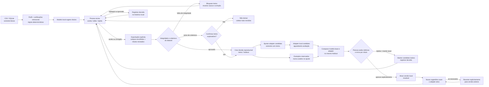

# FinLabel Supervised Training Lifecycle Implementation Plan

> **For agentic workers:** REQUIRED SUB-SKILL: Use `superpowers:subagent-driven-development` or `superpowers:executing-plans` to implement this plan task-by-task. Follow `.scratch/biblioteca-rotulagem-financeira/LOOP.md`; work one ticket at a time and stop for human review.

**Goal:** Complete the local, human-supervised lifecycle from reviewed labels through dataset gates, isolated fine-tuning/evaluation, explicit adapter activation, and rollback in the Python library and CLI.

**Architecture:** Extend existing Python services in `codigo/finlabel/.worktrees/integration`; CLI delegates to domain services. Training consumes only a gated training partition, evaluation uses a disjoint holdout, and registry activation is a separate human-confirmed operation. The React interface is planned separately in `2026-10-20-finlabel-react-local-panel.md` and consumes the contracts produced here.

**Tech Stack:** Python 3.10+, existing FinLabel package, Transformers, PEFT/LoRA. Core ML dependencies remain optional and lazy-loaded.

**Spec:** `docs/superpowers/specs/2026-10-20-supervised-training-lifecycle-design.md`; overall product scope remains `.scratch/biblioteca-rotulagem-financeira/2026-10-19-design-mvp.md`.

## Global Constraints

- “Fonte original: CSV e SQLite no MVP, por conectores extensíveis e somente leitura.”
- “Treino nunca começa automaticamente.”
- “Falhas de integridade bloqueiam o treino.”
- “Cobertura baixa ou desbalanceamento mostram ressalvas e podem permitir treino exploratório somente após confirmação explícita.”
- “Mínimo por rótulo configurável.”
- “Comparar modelo-base e adapter nos mesmos exemplos reservados que não participaram do ajuste.”
- “Pessoa decide entre ativar o adapter e manter o modelo-base/adapter atual; não há promoção automática.”
- “Versões locais imutáveis com proveniência; ativar explicitamente e permitir reversão para versão anterior.”
- “Nenhuma linha de dados ou prompt com valores de registros segue para LLM externa, telemetria ou hub.”
- Follow `.scratch/biblioteca-rotulagem-financeira/LOOP.md`: no automated tests may be added or run without explicit user request. Use the specified manual acceptance checks and record commands not run in the issue. Do not download model weights or run training until project model/license/hardware/data/evaluation prerequisites are recorded and the training run is explicitly authorized.
- Work in `codigo/finlabel/.worktrees/integration`; do not modify sibling `analytics` or `labeling` worktrees.

## Workflow visual

**Leitura do fluxo:** a revisão humana produz os únicos rótulos que podem entrar no dataset. Problemas de integridade encerram o caminho para treino; cobertura baixa permite seguir somente com confirmação explícita no próprio comando de treino. O holdout é separado antes do ajuste e alimenta apenas a avaliação comparativa. Mesmo um resultado aprovado não se ativa sozinho: a pessoa decide ativar, rejeitar ou depois reverter. Cada nova sugestão retorna à revisão; clicar em aceitar não altera pesos.

## Review Focus

- Malformed, hash-mismatched, empty, or stale datasets must be blocked before importing/loading model weights (Task 1 manual check).
- Below-minimum/imbalanced labels must show counts and require explicit exploratory confirmation at train time; thresholds are not quality guarantees (Task 1 manual check).
- Changed source digests and duplicate provenance must not silently enter a partition (Task 2 manual check).
- No holdout example may reach the trainer; base and adapter must receive identical heldout prompts (Tasks 2–3 manual check).
- Adapter evaluation, activation, or rollback failures must leave the prior active model/version intact (Tasks 4–5 manual check).

---

## File Map

Repository root for implementation: `codigo/finlabel/.worktrees/integration/`.

- Modify `src/finlabel/labeling/task.py`: configurable minimum examples per label.
- Create `src/finlabel/training/quality.py`: dataset checks and gate report.
- Create `src/finlabel/training/split.py`: deterministic train/holdout construction and provenance.
- Modify `src/finlabel/training/dataset.py`, `backend.py`: manifest validation, split-aware training.
- Modify `src/finlabel/models/text_generation.py`: optional local PEFT adapter loading.
- Create `src/finlabel/training/evaluation.py`: base/candidate predictions and task metrics.
- Create `src/finlabel/training/registry.py`: candidate states, immutable versions, active pointer and rollback.
- Modify `src/finlabel/cli.py`: gate, split, evaluate, version, activation and rollback commands.
- Modify `README.md`: commands, limits, data/model requirements.
- Create one `.scratch/biblioteca-rotulagem-financeira/issues/NN-*.md` file for each authorized ticket, following the local issue tracker conventions.

### Task 1: Dataset quality gate and per-label coverage

**Files:**
- Modify: `src/finlabel/labeling/task.py`
- Create: `src/finlabel/training/quality.py`
- Modify: `src/finlabel/training/dataset.py`
- Modify: `src/finlabel/cli.py`

**Interfaces:**
- Extend `LabelTask` with `min_examples_per_label: Mapping[str, int] = {}`. Keys must be task labels; values are positive integers. Existing task JSON without this property remains valid.
- `DatasetQualityReport(total: int, label_counts: Mapping[str, int], duplicate_suggestion_ids: int, duplicate_event_ids: int, duplicate_examples: int, excluded_counts: Mapping[str, int], source_snapshot_matches: bool, warnings: Sequence[str], blockers: Sequence[str], ready: bool)`.
- `inspect_training_dataset(project: ProjectConfig, dataset_path: PathLike) -> DatasetQualityReport` resolves task/source from local manifests and validates dataset hash, row count/schema, task labels, unique provenance, current CSV/SQLite snapshot, duplicates and configured coverage without importing ML libraries. A changed/unverifiable source snapshot is a blocker.
- Block malformed manifest/hash/schema, empty dataset, unknown labels, duplicate event/suggestion IDs, or any stale-source exclusions. Treat identical prompt/completion rows as a warning for human review; do not silently delete. Coverage below configured minima and label imbalance are warnings.
- CLI: `finlabel dataset check DATASET` reports readiness but never authorizes training. The check cannot save or reuse consent.

- [ ] Add backward-compatible parsing and validate unknown labels, booleans, zero, negative, and non-integer minimum values.
- [ ] Implement quality report generation without importing torch, Transformers, PEFT, or TRL.
- [ ] Print blockers, warnings, label counts and the next action; blockers make training impossible. Warnings require confirmation later in the explicit train command.
- [ ] Manually inspect valid, empty, hash-mismatched, stale, unknown-label, duplicate-provenance, duplicate-content, missing-label, and below-minimum fixtures; confirm check does not import ML packages.
- [ ] Record manual evidence and unrun automated tests in the issue, mark `ready-for-human`, and stop for review before Task 2.

### Task 2: Deterministic train/holdout bundle

**Files:**
- Create: `src/finlabel/training/split.py`
- Modify: `src/finlabel/training/dataset.py`
- Modify: `src/finlabel/cli.py`

**Interfaces:**
- `SplitConfig(strategy: str, holdout_fraction: float, seed: int, group_column: Optional[str] = None, time_column: Optional[str] = None)`.
- Supported strategies: `stratified_random`, `temporal` with an explicitly selected time column, and `group` with an explicitly selected group column. Never infer time/group fields from column names.
- `TrainingBundle(train_path: Path, holdout_path: Path, manifest_path: Path, quality_report: DatasetQualityReport, train_count: int, holdout_count: int, split_sha256: str, warnings: Sequence[str])`. The bundle manifest contains the report and dataset hash so training can re-validate it without trusting UI state.
- `create_training_bundle(project: ProjectConfig, dataset_path: PathLike, task: LabelTask, config: SplitConfig, output_dir: PathLike) -> TrainingBundle` resolves source/run through local manifests, re-reads only the explicitly selected split key, verifies row digests, then writes train and holdout JSONL with the existing `prompt`/`completion` fields. Manifest stores dataset hash, strategy, seed, counts, label distributions and opaque suggestion/event IDs only; no raw time/group values.
- CLI: `finlabel dataset split DATASET --strategy stratified_random|temporal|group --holdout-fraction FRACTION --seed INTEGER --output DIR [--time-column COLUMN] [--group-column COLUMN]`.

- [ ] Validate split parameters and reject strategy/key mismatches, missing values in the chosen key, changed source digests, unsupported data types, or existing output directories.
- [ ] Implement deterministic stratified assignment by label; fail with a clear error if class support cannot appear in both partitions.
- [ ] Implement temporal assignment by explicit time values with stable chronological ordering and suggestion ID tie-break; implement group assignment with seeded group ordering while keeping each group in one partition.
- [ ] Guarantee no suggestion/event ID crosses partitions. Warn when temporal/group assignment cannot preserve label support; never silently fall back to random splitting.
- [ ] Manually repeat splits with the same seed and compare hashes, change the seed, inspect row IDs and manifests, and verify no raw group/time fields appear in artifacts.
- [ ] Update issue to `ready-for-human`; stop for review before Task 3.

### Task 3: Train on the training partition only

**Files:**
- Modify: `src/finlabel/training/backend.py`
- Modify: `src/finlabel/cli.py`

**Interfaces:**
- Change to `train_adapter(bundle: TrainingBundle, config: TrainingConfig, *, gate_path: PathLike, exploratory_confirmed: bool = False) -> TrainingResult`. Re-validate the dataset/bundle hashes, stored quality report and existing model/license/hardware/data/evaluation authorization gate before loading ML libraries.
- `TrainingResult` adds `adapter_sha256: str` and `split_sha256: str` alongside its existing local output/base-model/dataset fields.
- CLI: `finlabel train BUNDLE_DIR ... [--confirm-exploratory]`. A warning report without the flag is rejected; blockers remain non-overridable.

- [ ] Validate dataset, quality report, bundle manifest and user confirmation before importing ML libraries or loading weights.
- [ ] Pass only `bundle.train_path` to `SFTTrainer`; fail closed if paths/hashes do not match bundle manifest.
- [ ] Save adapter/metadata in a unique local candidate directory; refuse overwrite, disable reporting/push integrations, and include dataset/split hashes and versions.
- [ ] Manually use a fake trainer/backend to inspect trainer inputs and confirm holdout path is never opened; confirm missing confirmation and blockers fail before optional ML imports.
- [ ] Do not download weights or run real training. Record this boundary, mark the issue `ready-for-human`, and stop for review before Task 4.

### Task 4: Candidate evaluation and adapter inference

**Files:**
- Modify: `src/finlabel/models/text_generation.py`
- Create: `src/finlabel/training/evaluation.py`
- Modify: `src/finlabel/cli.py`

**Interfaces:**
- Extend `TransformersTextGenerationBackend(model_id: str, revision: Optional[str] = None, device: str = "auto", adapter_path: Optional[PathLike] = None)` to lazily load the optional PEFT adapter. Preserve base-only behavior, no remote code execution and local-only operation.
- `LabelMetrics(label: str, support: int, precision: Optional[float], recall: Optional[float], f1: Optional[float])`.
- `EvaluationReport(base_model_ref: str, adapter_path: Path, adapter_sha256: str, dataset_sha256: str, split_sha256: str, overall: Mapping[str, float], per_label: Sequence[LabelMetrics], confusion: Mapping[str, Mapping[str, int]], error_ids: Sequence[str], warnings: Sequence[str])`.
- `evaluate_candidate(bundle: TrainingBundle, task: LabelTask, adapter_path: PathLike, *, output_path: PathLike) -> EvaluationReport` runs base and PEFT-backed models on identical holdout prompts and writes a local report.
- Classification metrics: overall accuracy and macro-F1; precision, recall, F1 and support by configured label. Undefined metrics serialize as `null`, not zero. Include confusion counts and malformed-prediction counts.
- The evaluation service is callable from the CLI and web after Task 5 registers candidates; the canonical command is defined in Task 5 as `finlabel model evaluate VERSION_ID --output PATH`.

- [ ] Use the same tokenizer, prompt format, decoding settings and holdout order for base and adapter; reject a candidate whose model revision/task schema is incompatible.
- [ ] Validate every generated label; count malformed/unknown outputs as invalid predictions and include them in support/metrics denominator behavior consistently.
- [ ] Persist hashes, counts, warnings and opaque error record IDs; show selected field values only on explicit local detail inspection.
- [ ] Manually inspect a fixture with an overall improvement plus a per-label regression; confirm holdout hash is unchanged and both backends received identical prompts.
- [ ] Do not load real weights. Record limitation, mark issue `ready-for-human`, and stop for review before Task 5.

### Task 5: Local model registry, activation and rollback

**Files:**
- Create: `src/finlabel/training/registry.py`
- Modify: `src/finlabel/cli.py`

**Interfaces:**
- `ModelVersion(version_id: str, base_model_ref: str, adapter_path: Path, adapter_sha256: str, bundle_manifest_path: Path, dataset_sha256: str, split_sha256: str, evaluation_path: Optional[Path], created_at: str, state: str)`.
- `ModelRegistry(workspace_dir: Path)` exposes `register_candidate(...)`, `record_evaluation(version_id, report_path)`, `reject_candidate(version_id, reason)`, `list_versions()`, `activate(version_id)`, `active()`, and `rollback(version_id)`.
- State path: `.finlabel/models/versions/<version_id>/manifest.json`; append-only decisions: `.finlabel/models/versions/<version_id>/events.jsonl`; active pointer: `.finlabel/models/active.json`. Candidate states are derived from events and are `awaiting_evaluation`, `awaiting_approval`, `rejected`, `active`, and `superseded`; version manifests remain immutable.
- `record_evaluation` accepts only a report whose adapter/dataset/split hashes match the candidate. Activation is allowed only from `awaiting_approval`.
- CLI: `finlabel model versions|active|evaluate|activate|reject|rollback ...`; `finlabel model evaluate VERSION_ID --output PATH` resolves the registered bundle/candidate. State-changing model decisions require explicit confirmation (`--confirm` or `--reason` plus confirmation for rejection).

- [ ] Register complete training artifacts as `awaiting_evaluation`; verify candidate path/hash and keep version metadata immutable except for append-only state/decision events.
- [ ] Add evaluation and rejection transitions; rejected candidates remain stored and never become active.
- [ ] Validate the complete adapter before switching active reference; write a temporary pointer and atomically replace so any failure preserves previous active version.
- [ ] Rollback only to an intact version; record decision history and leave all artifacts in place.
- [ ] Manually register/activate a fake candidate, corrupt or remove files to exercise blocked activation, reject a candidate, activate a second version, then rollback and inspect unchanged prior manifests.
- [ ] Mark issue `ready-for-human` and stop for review before Task 6.

### Task 6: CLI lifecycle integration and documentation

**Files:**
- Modify: `src/finlabel/cli.py`
- Modify: `README.md`

**Interfaces:**
- End-to-end command flow: `dataset prepare` → `dataset check` → `dataset split` → explicit `train` → `model evaluate` → explicit `model activate` or `model reject` → optional `model rollback`.
- Keep existing inspect/label/review/dataset prepare semantics. A legacy `train DATASET` call must explain how to create a split bundle rather than train on the entire dataset.

- [ ] Keep command handlers thin; delegate validation, evaluation and transitions to their domain services.
- [ ] Print paths, hashes, counts, coverage, warnings and current model state; never print record values/prompts by default.
- [ ] Manually execute every CLI transition using fake backends/fixtures; verify invalid ordering, missing confirmation, hash mismatch and rollback failure do not change active state.
- [ ] Document split strategies, minimum counts, warnings/confirmation, metrics, model versions, rollback, local-data policy, and academic limitations.
- [ ] Update each local ticket to `ready-for-human`, recording files, manual evidence, limitations and automated commands not run. Stop for whole-plan human review.

## Completion Gate

The Python/CLI lifecycle is ready for review when integrity blockers and coverage warnings behave as specified; train/holdout are isolated and reproducible; base and adapter are compared on the same reserved examples; only explicit human decisions activate a candidate; version rollback works; and data/artifacts remain local. The React web integration is the dependent follow-on plan. Automated tests and real model training remain unrun unless separately authorized.
