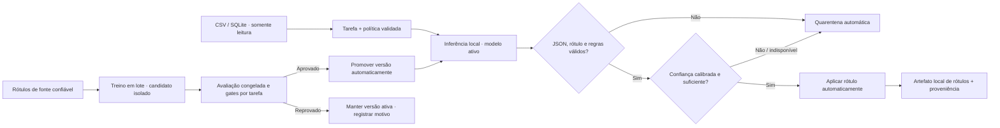

# Design: rotulagem autônoma e ciclo local de modelos FinLabel

**Data:** 2026-10-21
**Estado:** especificação aprovada em conversa; aguarda revisão escrita antes do plano e da implementação.
**Substitui:** `2026-10-19-design-mvp.md` e `2026-10-20-supervised-training-lifecycle-design.md` nos pontos de revisão humana obrigatória, treino sob demanda e ativação manual.

## Objetivo

Evoluir o MVP FinLabel de sugestões com revisão individual para um fluxo autônomo local. Depois que uma tarefa e sua política forem configuradas, o FinLabel classifica registros sem esperar aprovação humana por registro, aplica automaticamente resultados válidos e coloca resultados inválidos ou incertos em quarentena. Em lotes, pode treinar, avaliar e promover versões de modelo automaticamente, mas somente com rótulos de referência confiáveis e gates definidos para aquela tarefa.

O objetivo não é permitir que o modelo declare corretas as próprias previsões. Sem fonte confiável de supervisão, o sistema pode inferir e monitorar, mas não pode usar suas previsões como verdade de treino nem promover um adapter novo.

## Decisões aprovadas

- Remover aceitação, correção, rejeição e aprovação humana por registro do fluxo normal de inferência.
- Aplicar automaticamente previsões que passem validação estrutural, regras da tarefa e política de confiança calibrada.
- Encaminhar previsões inválidas, conflitantes, fora da cobertura ou sem confiança calibrada para quarentena automática. Quarentena não bloqueia outros registros e não exige revisão humana.
- Manter dados de entrada somente leitura. Salvar rótulos aplicados, previsões, quarentena e proveniência em artefatos locais separados.
- Distinguir previsões do modelo de rótulos de referência confiáveis. Somente as fontes de rótulos configuradas e validadas podem alimentar fine-tuning supervisionado e avaliação de promoção.
- Executar treinamento em lote e promoção de forma automática somente após suficiência de dados confiáveis, avaliação congelada e aprovação de todos os gates específicos da tarefa.
- Se política, fonte confiável, avaliação congelada ou gates estiverem ausentes, abster-se ou manter a versão ativa; nunca aplicar um limite universal presumido.
- Preservar operação local, conectores CSV/SQLite somente leitura, CLI e painel web local, tarefas configuráveis e a biblioteca Python compartilhada.
- O painel e a CLI apresentam execuções, contagens, abstenções, motivos, versões, métricas, promoções e rollbacks; não solicitam decisões humanas por linha nem aprovação manual de promoção.

## Usuários e sucesso

O usuário principal continua sendo um desenvolvedor que conecta fonte e configura uma tarefa reutilizável pela biblioteca Python, CLI ou painel local. A configuração inicial da tarefa e de seus critérios continua sendo explícita; autonomia significa que as execuções e decisões dentro dessa política não aguardam uma pessoa para cada registro.

O fluxo será demonstrável quando a mesma tarefa configurada puder processar uma fonte local repetidamente, escrever resultados aceitos por sua política em um artefato de saída, isolar automaticamente casos que não podem ser classificados com segurança, e executar um ciclo de treino/avaliação/promoção sem aprovação por registro. Falhas de qualidade devem manter a versão ativa anterior e produzir um registro local explicando o gate que falhou.

## Fluxo de dados e modelo

O serviço de inferência recebe somente as colunas selecionadas pela tarefa. A saída bruta do modelo, a decisão aplicada e os dados de referência não são confundidos. Campos selecionados não são gravados em logs operacionais por padrão. Identificadores persistidos devem ser opacos ou derivados de digest conforme configuração.

## Decisão automática por registro

Cada execução produz um estado terminal por registro:

1. **Aplicado:** a resposta pode ser analisada, o rótulo pertence ao conjunto permitido, as regras determinísticas não encontraram conflito e a política calibrada da tarefa aceitou a previsão.
2. **Quarentena:** saída inválida, rótulo desconhecido, violação de regra, fonte stale, confiança não calibrada/insuficiente ou erro de inferência. O registro não recebe rótulo final.

O sistema registra o motivo codificado da quarentena e mantém a execução de outros registros sempre que tecnicamente seguro. Não chama uma LLM externa nem altera a fonte original. Quarentena é um estado final automático daquela execução; uma pessoa pode estudar o relatório fora do caminho operacional, mas não é uma etapa necessária para a biblioteca continuar.

### Confiança

O MVP não deve interpretar texto livre de justificativa nem uma pontuação autorreportada pelo LLM como probabilidade confiável. Cada backend precisa fornecer um método validável de confiança ou abstinência. A calibração ocorre contra dados confiáveis separados da partição de treino. Sem calibração suficiente para a tarefa, as previsões ficam em quarentena; não existe threshold universal nem aceitar tudo como fallback.

O relatório inclui cobertura (fração aplicada), taxa de quarentena e qualidade no conjunto confiável de avaliação. Cobertura e qualidade são apresentadas juntas para evitar que um sistema pareça bom por classificar poucos registros.

## Supervisão e ciclo automático de treinamento

As fontes de rótulos são tipadas por proveniência. A configuração especifica quais fontes fornecem referência confiável, seu mapeamento para a taxonomia da tarefa e seus limites de uso. Exemplos de previsões do modelo, mesmo que tenham alta confiança ou passem pelas regras, nunca são promovidos automaticamente a rótulos de referência.

Quando a quantidade mínima e a cobertura configuradas de rótulos confiáveis estiverem disponíveis:

1. validar proveniência, snapshots, IDs, duplicações, classes e integridade;
2. separar treino, calibração e holdout antes de treinar, segundo estratégia registrada;
3. treinar um candidato isolado em lote usando somente a partição de treino;
4. comparar candidato e versão ativa no mesmo holdout congelado e avaliar calibração/cobertura;
5. promover automaticamente apenas se todas as métricas por classe e gates configurados forem satisfeitos;
6. em caso de falha, manter a versão ativa, registrar resultados/motivos e colocar o candidato como rejeitado/inativo;
7. preservar a versão anterior e permitir rollback automático se o monitoramento de saúde pós-promoção violar gates configurados.

Não há gate de confirmação manual no ciclo operacional. A política/gates precisam existir antes da execução e não podem ser alterados usando os resultados do próprio holdout. Se faltar rótulo confiável ou avaliação congelada, o treino/promoção não inicia.

## Interfaces

### CLI e Python

CLI e API Python expõem as mesmas operações de domínio. A experiência principal passa a ser executar uma tarefa ou um ciclo local, consultar seu estado e ler artefatos de resultados/quarentena. Os comandos não devem exigir `finlabel review` para dar continuidade ao processo. Operações de política são declarativas e versionadas, não prompts de aprovação interativa por linha.

### Painel local

O painel deixa de usar a fila “Revisar sugestões” como destino principal. A tela apresenta execução automática, totais aplicados/em quarentena, tendências de cobertura e motivos, proveniência/modelo ativo, ciclo de treino, candidatos, avaliação, promoção/rollback automáticos e histórico. Valores brutos permanecem ocultos até uma operação local de inspeção deliberada e não são exportados em relatórios agregados por padrão.

O ciclo de treino mostra graficamente: fontes de rótulo confiáveis → validação/proveniência → split congelado → treino de candidato → avaliação/gates → promoção automática ou manutenção da versão ativa → rollback por monitoramento. A interface não oferece botões de aceitar/corrigir/rejeitar para completar o fluxo normal.

## Persistência e proveniência

Os resultados de cada execução são imutáveis e locais. Cada item inclui referência opaca do registro, digest dos campos selecionados, ID da tarefa e versão da política, rótulo previsto, estado aplicado/quarentena, código de motivo, modelo/revisão/adapter, timestamp e hash do artefato. Prompt e valores completos não vão para logs por padrão.

Os rótulos confiáveis e a avaliação de referência têm armazenamento e contrato separados das previsões. Artefatos de treino registram snapshot, hashes, origem dos rótulos, configuração, split, métricas, gates e resultado de promoção. A fonte CSV/SQLite permanece somente leitura. Retenção avançada, multiusuário e conformidade regulatória continuam fora do MVP.

## Falhas e operação segura

- Modelo ausente/incompatível ou download falha: não fabricar resultados; registrar erro da execução e preservar saídas anteriores.
- Formato inválido ou classe desconhecida: quarentena.
- Fonte muda durante execução: marcar resultados afetados stale e excluir da promoção/treino.
- Falta confiança calibrada: abster-se e colocar em quarentena.
- Fonte ou cobertura de rótulos confiáveis insuficiente: não treinar.
- Treino ou avaliação falha: candidato não promovido e versão ativa preservada.
- Métricas abaixo de gates: rejeição automática, relatório local e nenhuma confirmação manual necessária.
- Monitoramento pós-promoção detecta regressão conforme política: rollback para última versão íntegra e registrar evento.
- Nenhum erro de parsing, timeout ou ausência de confiança pode ser convertido em rótulo por fallback silencioso.

## Fora do escopo

- Enviar linhas para uma LLM externa ou serviço hospedado.
- Escrever rótulos na fonte original.
- Usar previsões próprias como ground truth para treino ou holdout.
- Threshold universal para toda tarefa/backend.
- Prometer classificação correta, conformidade regulatória ou suporte a qualquer modelo/fonte.
- Fazer fine-tuning sem rótulos confiáveis suficientes e avaliação independente.
- Decidir crédito, aprovar/rejeitar clientes ou recomendar ação financeira em produção.

## Critérios de aceite

1. A mesma política declarativa é usada por biblioteca, CLI e painel local.
2. Uma execução processa registros sem aprovação humana individual e grava previsões aplicadas separadamente da fonte somente leitura.
3. Saídas inválidas, não calibradas, incertas, conflitantes ou stale terminam em quarentena com motivo explícito.
4. A interface apresenta cobertura, taxa/motivos de quarentena, qualidade da avaliação confiável e provenance do modelo.
5. Previsões do modelo não são elegíveis como rótulos confiáveis para treino ou avaliação.
6. Quando gates de dados confiáveis são satisfeitos, treino/avaliação/promoção podem ocorrer em lote sem confirmação manual.
7. O candidato só é promovido após avaliação congelada e gates previamente versionados; falha mantém a versão ativa e registra motivo.
8. Rollback automático pode restaurar a versão anterior quando gates pós-promoção forem violados.
9. A CLI, painel e documentação não exigem a antiga etapa humana de aceitar/corrigir/rejeitar para completar rotulagem ou treinamento.
10. Dados permanecem locais; CSV/SQLite são somente leitura e logs não contêm valores brutos por padrão.

## Plano de decomposição esperado

Implementar por entregas revisáveis: contratos de política/proveniência; estados aplicados/quarentena e persistência; serviço de batch de inferência; calibração e gates de abstenção; fontes confiáveis e split congelado; treinamento/avaliação/promoção/rollback automáticos; CLI; painel e diagrama; migração e documentação. Cada entrega deve preservar a capacidade de operar sem revisão individual. Definir no plano como artefatos legados de revisão serão lidos ou mantidos apenas para compatibilidade histórica.

## Questões resolvidas para a implementação

- A decisão de produto é remover revisão humana obrigatória por registro.
- Retreino é permitido em lote somente com rótulos de referência confiáveis.
- Promoção automática é aprovada somente após avaliação congelada e gates configurados por tarefa.
- Sem política de confiança validada, quarentena; sem referência/holdout confiável, sem treino/promoção.
- A confirmação humana não faz parte do caminho operacional. Os critérios precisam ser configurados previamente e permanecer rastreáveis.
