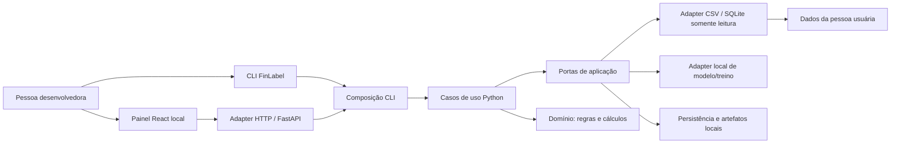
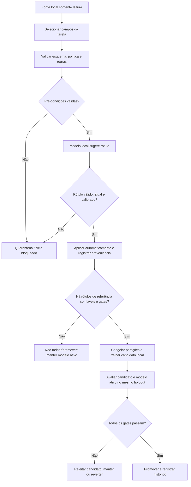

# Relatório do projeto FinLabel e sua relação com o TCC

**Autor:** Rodrigo Mialichi Triboni  
**Atualizado em:** 26 de outubro de 2026  
**Repositório:** `codigo/finlabel`  
**Branch integrada:** `codex/finlabel-autonomous-mvp`  
**Commit consultado:** `257e90d`

## 1. Para que serve este relatório

Este documento explica, em linguagem direta, o que foi construído no FinLabel, como as partes se conectam, o que já foi verificado e o que ainda não foi demonstrado. Também separa o estado do software do estado acadêmico do TCC: ter um protótipo funcionando não significa que o novo recorte já substituiu formalmente o projeto submetido.

## 2. Resumo executivo

O **FinLabel Local** é uma biblioteca Python em desenvolvimento para conectar dados financeiros locais, monitorar a estrutura desses dados, executar análises configuráveis e apoiar a rotulagem com modelos locais. Ela oferece uma CLI e um painel web local. As fontes CSV e SQLite são abertas em modo somente leitura.

O foco do produto evoluiu para um fluxo configurável e reutilizável. A pessoa define uma tarefa, as colunas permitidas, os rótulos e as políticas. O sistema pode aplicar automaticamente previsões que satisfaçam as regras e os critérios de confiança configurados; casos inválidos, incertos ou sem evidência de calibração são colocados em quarentena. Rótulos de referência confiáveis podem alimentar um ciclo local de treino, avaliação e promoção sujeito a gates. Sem política ou evidência validada, o fluxo falha de forma segura e não promove um modelo.

O protótipo foi reorganizado em arquitetura limpa e hexagonal, tem testes de Python e frontend e passou por verificações HTTP locais com dados sintéticos. Também há um experimento anterior de inferência real de um adapter Qwen LoRA com 24 exemplos sintéticos. **Esse resultado não mede desempenho em crédito real e não comprova que o ciclo autônomo atual treinou ou promoveu um modelo.**

## 3. O produto que foi criado

### Capacidades do protótipo

- **Projetos e fontes locais:** configuração de workspace e conectores CSV/SQLite somente leitura.
- **Perfil e monitoramento estrutural:** leitura de esquema, mapeamento explícito de tipos e comparação com um esquema confirmado.
- **Análise configurável:** cálculos determinísticos como contagem, soma, média, valores distintos e participação no total; gráficos e indicadores, incluindo heatmap de categoria por período quando o plano e os dados fornecem essas dimensões.
- **Rotulagem autônoma configurável:** tarefa declarativa com instruções, colunas selecionadas, classes e política de validação.
- **Quarentena:** previsões que falham regras, têm rótulo inválido, estão desatualizadas ou não possuem calibração compatível não são aceitas automaticamente.
- **Ciclo de treino controlado:** preparação de rótulos confiáveis, partições congeladas de treino/calibração/holdout, avaliação de candidato e incumbente, gates de promoção, rejeição e rollback.
- **CLI e painel:** os fluxos disponíveis podem ser operados por comandos e pela interface web local. O painel inclui análise, monitoramento, rotulagem e visualização do ciclo de treinamento.
- **Rastreabilidade local:** manifests, referências opacas, hashes e artefatos locais registram as execuções sem gravar as linhas brutas da fonte nos resumos apresentados.

O backend pode integrar Transformers para inferência e PEFT/LoRA/TRL para treino, como dependências opcionais. O pacote base não precisa carregar essas dependências; pesos são necessários somente quando uma operação local de modelo é selecionada.

### Fluxo do sistema

No desenho hexagonal, casos de uso dependem de contratos (portas); conectores, persistência, web e runtimes de modelos ficam em adapters. As referências públicas antigas do pacote são mantidas como fachadas de compatibilidade.

### Ciclo autônomo de rotulagem e treino

O painel mostra as etapas do ciclo de treinamento. Uma rodada é iniciada por comando ou ação explícita; o programa não instala um serviço daemon que treina continuamente em segundo plano.

## 4. O que foi comprovado até agora

### Verificação de software

Na branch integrada `codex/finlabel-autonomous-mvp`, os resultados finais foram:

| Verificação | Resultado |
|---|---:|
| Suíte Python | 407 testes e 17 subtestes passaram |
| Suíte frontend | 51 testes passaram em 8 arquivos |
| Build frontend | Passou |
| Lint frontend | Exit 0, com cinco avisos já registrados |
| `compileall` e `git diff --check` | Passaram sem diagnósticos |
| Revisão independente da arquitetura | Dois achados importantes corrigidos; revisão focada aprovou as correções |

Os avisos conhecidos são cinco regras de lint em componentes/páginas React e o aviso do build sobre um bundle minificado acima de 500 kB. Eles não impediram os comandos de terminar com sucesso.

### Verificação HTTP e interface

Com um projeto sintético local, foram verificadas as rotas `/`, `/analysis`, `/monitor`, `/labeling`, `/review` e `/training`, incluindo navegação direta e reload. O diagrama de treino mostrou as sete etapas. Os endpoints de sugestão e de envio/status de treino foram exercitados; o endpoint de treino usou um stub e não iniciou fine-tuning. Requisições chunked excessivas e hosts não confiáveis foram rejeitados. O hash SHA-256 do CSV sintético permaneceu igual, evidenciando que a fonte não foi alterada nessa verificação.

O navegador disponível permitiu inspeção em **1280×682**. As dimensões exatas **1440×900** e **390×844** ainda não foram verificadas, porque a automação desta sessão não ofereceu controle de viewport. O relatório detalhado está em [task-13-report.md](../codigo/finlabel/.worktrees/autonomous-mvp/.superpowers/sdd/2026-10-26-finlabel-clean-hexagonal/task-13-report.md).

### Experimento anterior com modelo local

Há um smoke test reproduzível de inferência com `Qwen/Qwen2.5-0.5B-Instruct` e um adapter LoRA local previamente treinado. Em **24 exemplos sintéticos reservados**, o modelo produziu 24 saídas válidas, acertou 17 (acurácia de 70,83%), obteve macro-F1 0,7056 e levou cerca de 12,1 segundos em Apple MPS.

Esse experimento é útil para provar que a integração local com o runtime Transformers consegue inferir sobre um pequeno exemplo sintético. **Não é resultado sobre South German Credit, sobre clientes, sobre risco real, nem sobre generalização.** O adapter foi criado antes do contrato atual de identidade/calibração e não pode ser promovido pelo ciclo autônomo atual. A evidência e o comando estão em [local-model-inference-2026-10-26.md](../codigo/finlabel/.worktrees/autonomous-mvp/docs/local-model-inference-2026-10-26.md).

## 5. O que ainda não foi comprovado

- Não foi demonstrada qualidade de rótulos em uma base real de crédito nem em dados de uma instituição.
- Não foi concluído um experimento de portabilidade formal usando duas bases financeiras e medindo as adaptações necessárias.
- Não foi medido que a biblioteca reduz tempo de desenvolvimento. Para sustentar essa afirmação, será necessário definir uma tarefa de referência, medir passos/tempo antes e depois ou comparar com uma implementação sem a biblioteca.
- O treino e a promoção do ciclo autônomo atual não foram executados com rótulos confiáveis reais; a verificação HTTP de treino utilizou um stub.
- No estado documentado, o backend Transformers não produz confiança calibrada por conta própria. Sem calibrador e política vinculados e validados, previsões permanecem em quarentena; não se deve dizer que o modelo está aplicando rótulos automaticamente em qualquer configuração.
- Não foi demonstrado compliance automático, eficácia de decisão de crédito, lucro, causalidade ou adequação regulatória.
- As rotas foram verificadas visualmente no viewport disponível, mas falta concluir QA nas dimensões de desktop e celular listadas acima.

## 6. Como o projeto se relaciona com o tema acadêmico

Há duas formulações nos documentos atuais, e é essencial não misturá-las:

1. O README principal do TCC ainda registra o tema submetido como **redes bayesianas e utilidade esperada para seleção de next best action**.
2. Os documentos mais recentes registram a nova direção discutida com o orientador: uma **biblioteca open source e reutilizável para rotulagem/análise local de dados financeiros**, com crédito como primeiro caso demonstrativo e reutilização do fluxo como foco.

Os próprios documentos da pasta `planejamento/` tratam a nova formulação como proposta para discussão e dizem que ela não substitui o protocolo experimental até ser aprovada. Portanto, o FinLabel está construído como software, mas a pergunta, o objetivo e a metodologia oficiais do TCC precisam ser formalmente alinhados com o orientador antes de reescrever a monografia ou abandonar o protocolo submetido.

### Pergunta de pesquisa candidata

> **Até que ponto um fluxo configurável de rotulagem financeira, implementado como biblioteca local, pode ser reaplicado a diferentes tarefas e bases sem alterar seu núcleo, mantendo rastreabilidade e controles de qualidade?**

Esta é uma proposta coerente com o foco declarado em reutilização, mas precisa ser validada pelo orientador. A pergunta evita prometer que o sistema serve para “qualquer base” e pode ser avaliada por evidências de adaptação e execução, em vez de depender de uma alegação vaga de facilidade.

### Objetivo geral candidato

Projetar e avaliar uma biblioteca local, configurável e extensível para executar fluxos de análise e rotulagem de dados financeiros, demonstrando quais etapas são reutilizadas e quais precisam ser adaptadas entre casos de uso.

### Objetivos específicos candidatos

1. Delimitar tarefas financeiras, bases, rótulos de referência e requisitos de privacidade para o experimento.
2. Identificar as etapas comuns do fluxo e representá-las por componentes reutilizáveis e contratos de dados.
3. Configurar o mesmo fluxo para um caso financeiro inicial sem modificar suas etapas centrais.
4. Aplicá-lo a uma segunda base/tarefa financeira aprovada e registrar as adaptações necessárias.
5. Avaliar a qualidade das saídas e a rastreabilidade com métricas adequadas ao caso, incluindo cobertura/quarentena quando a automação se abstém.
6. Documentar limites, riscos de vazamento, necessidade de calibração e diferenças entre desempenho de modelo e saúde de carteira.

Esses objetivos não significam que os experimentos já foram executados. O caso South German Credit e a base UCI Default of Credit Card Clients aparecem como candidatos nos documentos de proposta; a segunda base permanece sujeita a aprovação e análise metodológica.

## 7. Método experimental que pode ser discutido

Uma avaliação centrada na reutilização pode registrar, para cada caso:

- versão, origem, esquema, significado/codificação dos rótulos e licença da base;
- componentes do fluxo mantidos iguais e alterações feitas em configuração, adapter ou código central;
- quantidade de passos de configuração, alterações necessárias e tempo, se a alegação de economia de tempo for importante;
- divisão de dados e proteção contra vazamento, com teste reservado que não seja usado para ajustar o sistema;
- baseline apropriado e métricas de qualidade do rótulo, além de cobertura, abstenção/quarentena e resultados por segmento quando pertinente;
- execução reproduzível com sementes, versões, configuração, hashes e artefatos;
- limitações do dataset e das conclusões.

O protocolo existente no repositório foi escrito originalmente para comparar regressão logística, redes bayesianas e uma política de utilidade. Como o foco do produto mudou, esse protocolo precisa ser revisado antes de ser tratado como o método aprovado para avaliar o FinLabel. Se a decisão de crédito/next best action continuar no TCC, a qualidade preditiva e a utilidade simulada devem ser analisadas separadamente; a base não contém resultados contrafactuais das ações.

## 8. Próximas ações para o TCC

### Primeiro: alinhar com o orientador

Leve a ele o resumo deste relatório e confirme:

1. O FinLabel substitui o tema submetido de redes bayesianas/utilidade esperada ou será um protótipo complementar a esse estudo?
2. A contribuição central será reutilização de fluxo? Quais critérios observáveis demonstram reutilização?
3. Quais serão o caso inicial, a segunda base e os rótulos de referência? A South German Credit e a UCI Default of Credit Card Clients são adequadas?
4. O TCC deve executar fine-tuning real ou basta avaliar um fluxo com inferência local, baseline e revisão/quarentena? Que hardware e modelo são viáveis?
5. Qual protocolo de partições, métricas, baseline e análise de esforço deve ser aprovado antes dos experimentos?
6. Como registrar o uso de IA conforme as regras do curso e qual é o prazo oficial?

### Depois da orientação

1. Atualize a pergunta de pesquisa, os objetivos e o protocolo por escrito; registre a decisão do orientador.
2. Localize os artefatos das Semanas 2 e 3 que você informou já ter realizado e registre dados, scripts e resultados sem refazer o trabalho desnecessariamente.
3. Feche a versão das bases e o dicionário de dados; valide licença, target, codificação e riscos de vazamento.
4. Escolha um baseline e congele a avaliação antes de olhar os resultados finais.
5. Execute os dois casos de reutilização e guarde as evidências e adaptações.
6. Escreva resultados e limitações com base nos experimentos, não nas funcionalidades do protótipo.

## 9. Materiais para consultar

- [Proposta do fluxo reutilizável](../planejamento/Proposta_fluxo_reutilizavel.md) — direção de produto e critérios candidatos, ainda rascunho para orientação.
- [Épico do TCC](../.scratch/proximas-etapas-tcc/epico.md) — objetivo amplo, limites e decisões pendentes.
- [Protocolo experimental](../planejamento/Protocolo_experimental.md) — protocolo anterior; revisar para compatibilidade com o novo foco.
- [README do FinLabel](../codigo/finlabel/.worktrees/autonomous-mvp/README.md) — comandos, configuração e comportamento atual da biblioteca.
- [Documento de Clean Architecture](../codigo/finlabel/.worktrees/autonomous-mvp/docs/architecture/clean-hexagonal.md) — limites das camadas, portas, adapters e composição.
- [Relatório de validação integrada](../codigo/finlabel/.worktrees/autonomous-mvp/.superpowers/sdd/2026-10-26-finlabel-clean-hexagonal/task-13-report.md) — testes, verificações HTTP e limitações visuais.
- [Experimento de inferência local](../codigo/finlabel/.worktrees/autonomous-mvp/docs/local-model-inference-2026-10-26.md) — smoke test com dados sintéticos.
- [Pesquisa sobre análise de crédito e dashboard](../references/pesquisa-analise-de-credito-e-dashboard.md) — indicadores e distinção entre saúde da carteira e qualidade do modelo.

---

**Resumo para guardar:** você criou uma base de software concreta para trabalhar com dados financeiros localmente: biblioteca Python, CLI, API/painel, conectores, monitoramento, análise e fluxo autônomo de rotulagem/treino protegido por políticas e gates. O protótipo tem testes extensos e uma inferência local sintética já executada. O trabalho acadêmico agora precisa transformar a visão de reutilização em uma pergunta e num experimento aprovados pelo orientador; ainda não há evidência de generalização financeira nem de ganho de tempo.
