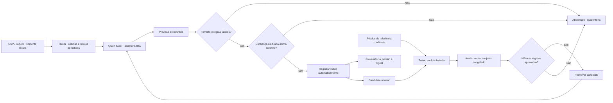

# LazyLabel: demonstração local e fluxo autônomo desejado

Este experimento demonstra inferência local para **rotulagem automática**. O objetivo do produto é operar sem uma pessoa aprovando cada registro. A demonstração usa categorias financeiras sintéticas, sem dados de clientes.

> **Estado atual:** a inferência real funciona, mas o produto ainda mostra sugestões na fila de revisão manual. Publicação autônoma, abstinência calibrada, quarentena e promoção automática de modelos ainda não estão implementadas. Os resultados abaixo comprovam a cadeia de inferência sintética, não o fluxo autônomo completo.

## Fluxo autônomo desejado



O modelo pode rotular e registrar automaticamente; uma saída inválida, ambígua ou fora do limite definido deve resultar em **abstenção**, nunca em um rótulo inventado. A fonte original segue somente leitura. Cada resultado precisa guardar a versão do modelo, tarefa, digest da entrada e validações aplicadas para ser auditável.

### Autonomia de inferência e de treinamento

Rotular automaticamente não significa que o modelo deve tratar suas próprias previsões como verdade. Isso pode criar um ciclo de realimentação que amplifica erros. Previsões podem entrar numa fila automática de candidatos, mas o treino em lote precisa de uma fonte de supervisão confiável para a tarefa — por exemplo, regras de domínio validadas ou um conjunto-ouro. O candidato deve ser avaliado contra um conjunto congelado e só pode substituir a versão ativa quando cumprir gates definidos antes do treino; se falhar, o sistema conserva a versão anterior.

Sem rótulos de referência confiáveis, o modo seguro é continuar inferindo, monitorar e abster-se nos casos incertos, sem fazer fine-tuning com pseudo-rótulos como se fossem corretos. Não há aprovação humana por linha no fluxo alvo, mas ainda são necessários critérios de qualidade definidos para permitir decisões automáticas.

## Modelo e tarefa do experimento

- **Modelo-base:** `Qwen/Qwen2.5-0.5B-Instruct`, revisão `7ae557604adf67be50417f59c2c2f167def9a775`.
- **Ajuste local:** adapter PEFT/LoRA separado dos pesos-base.
- **Hardware observado:** Apple Silicon, MPS; inferência gulosa (`do_sample=false`) com o chat template oficial do tokenizer Qwen.
- **Tarefa sintética:** `receita`, `despesa_operacional` ou `custo_financeiro`, usando apenas `historico`.
- **Dados:** 72 exemplos de treino e 24 exemplos reservados, gerados artificialmente; ambiente isolado em `.venv/`.

O backend genérico da CLI neste checkout não aplica automaticamente o chat template do Qwen. O script de avaliação aplica esse template explicitamente; não atribua seus resultados ao backend genérico sem essa integração.

## Reproduzir a avaliação do adapter

Execute a partir da raiz do repositório. A primeira execução pode baixar a revisão fixada do modelo para o cache Hugging Face. O adapter e os demais arquivos necessários estão nesta pasta do experimento.

```bash
EXP="$PWD/tcc/experimentos/sintetico-qwen-0.5b"
HF_HUB_DISABLE_TELEMETRY=1 "$EXP/.venv/bin/python" \
  "$EXP/scripts/evaluate.py" \
  --adapter "$EXP/adapter" \
  --output "$EXP/results/live-inference-2026-10-21.json" \
  --chat-template
```

Para avaliar o modelo-base, omita `--adapter`. Use o mesmo holdout e o mesmo `--chat-template` em ambas as execuções. O JSON registra métricas e as descrições sintéticas avaliadas.

## Resultado executado em 21/10/2026

| Medida | Adapter LoRA |
|---|---:|
| Exemplos reservados | 24 |
| Saídas com rótulo permitido | 24/24 (100%) |
| Acurácia exata | 17/24 (70,8%) |
| Macro-F1 | 0,706 |
| Tempo de inferência | 8,776 s |
| Dispositivo | MPS |

No registro anterior do mesmo protocolo, o modelo-base acertou 9/24 (37,5%) e o adapter 17/24 (70,8%). A amostra é pequena, artificial e compartilha padrões de linguagem entre treino e holdout; não permite concluir qualidade em dados reais.

## Demonstração no painel

A inferência ao vivo também gerou seis sugestões sintéticas com o modelo-base e o adapter: seis válidas, nenhuma inválida. O MVP colocou essas previsões na revisão manual existente:

`http://127.0.0.1:8765/review?run_id=f31089a288754258b182c78fb43d43fe&invalid=0`

Esse é o comportamento atual da interface, não o fluxo autônomo pretendido. A execução não aceitou, corrigiu nem rejeitou sugestões. Os dados e o projeto dessa demonstração estão em `/tmp/finlabel-live-demo` e `/tmp/finlabel-visual-qa-project`, então são temporários.

## O que falta para autonomia

1. Definir e implementar execução automática de inferência e persistência dos rótulos aprovados pelas regras da tarefa.
2. Validar esquema e regras determinísticas; saídas inválidas ou conflitantes devem ser abstidas e colocadas em quarentena.
3. Definir estratégia de confiança e calibrá-la em dados representativos; não usar a confiança textual do LLM como probabilidade sem calibração.
4. Definir quais fontes podem fornecer rótulos de referência confiáveis. Predições próprias não são ground truth.
5. Automatizar treino em lote como candidato isolado, comparar com baseline em avaliação congelada, promover só após gates predefinidos e manter rollback.
6. Monitorar mudanças de distribuição, taxa de abstenção, qualidade por rótulo e versões de modelo sem expor linhas ou dados sensíveis.

## Limites acadêmicos

Os 24 exemplos reservados têm rótulos artificiais e foram gerados por templates; não houve validação humana independente. O resultado não mede risco de crédito, desempenho em carteiras reais, causalidade, lucro, robustez ou conformidade. Para o TCC, a avaliação autônoma precisa de protocolo prévio, referência confiável, análise de erro por classe e separação que evite vazamento temporal ou por entidade.

Detalhes e proveniência: [`PROTOCOL.md`](PROTOCOL.md), [`RESULTS.md`](RESULTS.md), [`scripts/evaluate.py`](scripts/evaluate.py), [`adapter/`](adapter/) e [`results/live-inference-2026-10-21.json`](results/live-inference-2026-10-21.json). A visão do MVP LazyLabel está no [README do projeto](../../../../codigo/finlabel/.worktrees/visual-qa-overview/README.md).
